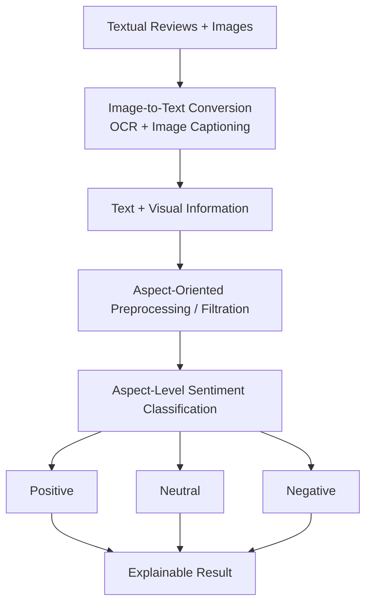

# MABSA

## An Explainable Multimodal Framework for Aspect-Based Sentiment Analysis using Image-to-Text Conversion and Aspect-Oriented Filtration

MABSA is an Explainable Multimodal Aspect-Based Sentiment Analysis framework designed to analyze customer opinions expressed through both **text and images**.

Traditional sentiment analysis systems mainly focus on textual information and may miss important visual cues present in customer feedback. MABSA addresses this limitation by combining textual and visual information through **Image-to-Text Conversion, OCR, Image Captioning, Aspect-Oriented Filtration, and Aspect-Level Sentiment Classification**.

The framework aims to provide more accurate, transparent, and explainable sentiment analysis for multimodal customer feedback.

---

## Project Overview

Customers increasingly express their opinions using a combination of textual reviews and images. A single review may contain positive sentiment toward one aspect and negative sentiment toward another.

For example:

> "Great camera, but the delivery was slow."

MABSA identifies the different aspects and associates a sentiment with each one:

| Aspect | Sentiment |
|---|---|
| Camera | Positive |
| Delivery | Negative |

By combining textual and visual information, MABSA provides a more complete understanding of customer feedback.

---

## Problem Statement

Customers express opinions through both text and images, but traditional sentiment analysis mainly focuses on text and may miss important visual information.

This can lead to incomplete sentiment understanding and inaccurate aspect-level analysis.

Therefore, an explainable multimodal framework is needed to combine textual and visual information for more accurate customer-feedback analysis.

---

## Objectives

- Develop an Explainable Multimodal Aspect-Based Sentiment Analysis framework.
- Analyze customer opinions using both text and images.
- Extract visual information using Image-to-Text Conversion, OCR, and Image Captioning.
- Perform aspect-level sentiment classification.
- Classify sentiment into Positive, Neutral, and Negative categories.
- Improve accuracy, transparency, and reliability through Explainable AI.
- Provide meaningful aspect-level insights from multimodal customer feedback.

---

## Key Features

### Multimodal Sentiment Analysis
Processes textual reviews, images, or both together to obtain a more complete understanding of customer opinions.

### Image-to-Text Conversion
Extracts useful information from images using:
- **Image Captioning** to describe the scene or product
- **OCR** to read any text written inside the image

### Aspect-Oriented Filtration
Keeps only the information relevant to the target aspect and reduces the influence of irrelevant content.

### Aspect-Level Sentiment Classification
Determines the sentiment associated with each aspect:
- Positive
- Neutral
- Negative

### Explainable Results
Provides interpretable results by connecting each aspect with its predicted sentiment.

---

## Supported Input Modes

| Mode | Input | Description |
|---|---|---|
| Text only | Review text | Sentiment is predicted from the text |
| Image only | Photo | Image-to-text conversion turns the image into text, then sentiment is predicted |
| Text + Image | Review and photo | Text and visual information are combined, then sentiment is predicted |

---

## Proposed Methodology

---

## Technologies and Tools

| Category | Tools |
|---|---|
| Technologies | Python, OpenCV, Pandas, NumPy |
| Tools / Frameworks | Transformers / Hugging Face, Git & GitHub, VS Code |
| Dataset | Twitter-2017 (official train / dev / test split) |

---

## Dataset

**Twitter-2017**: tweets with an image, a target aspect, and an aspect-level sentiment label (Negative, Neutral, Positive).

| Split | Samples |
|---|---|
| Train | 3,562 |
| Dev | 1,176 |
| Test | 1,234 |

Image-to-text was run on all 2,908 unique images: image captions for every image, and OCR text found in 1,800 of them.

---

## Results

Evaluated on the official Twitter-2017 test set (1,234 samples).

| Model | Input | Accuracy | Macro-F1 |
|---|---|---|---|
| Pretrained sentiment model (no aspect) | Text | 56.0% | 52.8% |
| Fine-tuned transformer (aspect-aware) | Text + aspect | 71.6% | 70.4% |
| Multimodal, no filtering | Text + aspect + caption + OCR | 71.1% | 69.6% |
| **MABSA (aspect-oriented filtration)** | Text + aspect + caption + filtered OCR | **72.5%** | **70.9%** |

**Observations**
- Making the model aspect-aware gives the largest gain (56.0% to 71.6%).
- Adding all image text without filtering slightly lowers performance, because OCR text is often irrelevant to the aspect.
- Aspect-oriented filtration of the image text gives the best result.
- The gain over the text-only model is small and comes from a single training run. Repeated runs with different random seeds are planned.

---

## Current Status

- [x] Image captioning
- [x] OCR
- [x] Three modes: text only, image only, text + image
- [x] Twitter-2017 dataset loading (train / dev / test)
- [x] Aspect-aware model training and evaluation
- [x] Image-to-text on the dataset images
- [x] Aspect-oriented filtration of image text
- [x] Multimodal model training and evaluation (72.5% test accuracy)
- [ ] Repeated runs with different seeds
- [ ] Explainable AI
- [ ] Final demo

---

## Expected Outcomes

- Comprehensive sentiment understanding using text and images
- Positive, Neutral, and Negative aspect classification
- Explainable sentiment predictions
- Improved transparency in customer-feedback analysis

---

## Impact and Practical Applicability

**Real-world impact:** Provides a deeper understanding of customer opinions by combining textual and visual information with aspect-level explainable sentiment analysis.

**Practical implementation:** Can be integrated into e-commerce, product-review, and social-media feedback systems to analyze multimodal customer opinions.

**Beneficiaries:** Businesses, product teams, marketing teams, customer support teams, researchers, and analysts.

---

## Sustainable Development Goal

**SDG 9: Industry, Innovation and Infrastructure**
Supports AI-driven innovation by enabling intelligent multimodal analysis for digital customer feedback.
